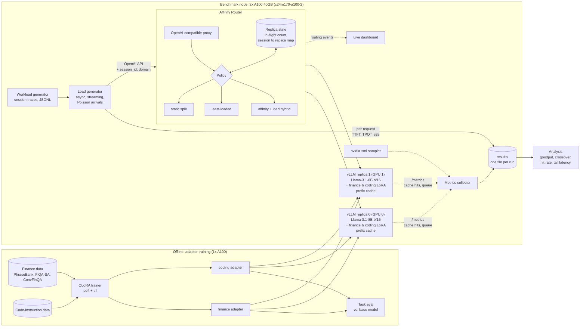

# Architecture

## System overview

## Key design decisions

**1. Both replicas load both adapters for every policy.** The vLLM servers stay identical across all runs, and only the router's decision rule changes. "Static split" then means the router sends every finance request to replica 0 and every coding request to replica 1. This isolates the variable we're studying (routing) and lets the servers stay up for the whole grid, with no restart between configurations. LoRA weights at rank 8 take a few tens of MB, so loading both costs almost nothing.

**2. Clean state between runs.** Before each run, the driver resets both replicas' prefix caches and the router's session map, then sends a short warm-up. Runs are independent and repeatable.

**3. The router tracks load itself.** vLLM's `/metrics` endpoint is scraped on an interval, so its numbers lag. The router counts in-flight requests per replica as it forwards and completes them, which is exact and immediate. `/metrics` is used only for reporting (cache hit rate, running and waiting counts), not for routing decisions.

**4. Sessions carry identity.** Each request includes a `session_id` and a `domain` (as headers or extra body fields). The router never parses prompts. This keeps it fast and makes affinity explicit.

**5. Timing is measured at the client.** The load generator streams responses and records TTFT (time to the first token), TPOT (average time per output token after the first) and end-to-end latency for each request. That's the latency a user would see, including the router's overhead.

## Components

### Workload generator (`workload/`)
- **Finance sessions:** a shared report context (ConvFinQA-style documents or filing excerpts, ~2–4k tokens) followed by several question turns.
- **Coding sessions:** a shared source file (~1–3k tokens) followed by several question or edit turns.
- Each turn's prompt is the full conversation so far, so later turns share a growing prefix with earlier ones. That shared prefix is what the cache can reuse.
- Output is a deterministic trace (JSONL): session id, domain, turn index, prompt messages, max output tokens. The mix is set by sampling sessions in the target finance:coding ratio, with a fixed seed.

### Load generator (`bench/loadgen`)
- Session starts follow a Poisson process. Each next turn is sent after the previous response finishes, plus a short think time. The rate parameter is calibrated to a target aggregate request rate.
- It uses an async HTTP client with streaming and writes one record per request.

### Affinity Router (`router/`)
- An async proxy (FastAPI or aiohttp) that exposes `/v1/chat/completions` and streams responses through.
- **static split:** `domain → fixed replica`.
- **least-loaded:** the replica with the fewest in-flight requests, ignoring sessions.
- **affinity + load hybrid:** send the request to the session's previous replica, unless that replica's in-flight count exceeds the other's by more than a threshold θ. In that case, send it to the other replica and update the session map. θ is fixed after one calibration check and is not swept.
- Emits a routing event (timestamp, session, chosen replica, reason) for the dashboard and for analysis.
- Policy logic is plain functions over the replica state, so it can be unit-tested without a GPU.

### vLLM replicas
- Two processes, each pinned to one GPU (`CUDA_VISIBLE_DEVICES`), run with `--enable-lora`, both adapters registered, and prefix caching on. The vLLM version is pinned, because metric names change between releases.

### Metrics and results
- Each run writes one directory containing the run config (policy, mix, rate, repeat, seed, vLLM version), per-request records, scraped `/metrics` snapshots, GPU utilization samples and router events.
- **Goodput** is the number of requests per second that meet both the TTFT and TPOT SLOs, measured over the steady-state window (warm-up and drain excluded).

### Analysis (`analysis/`)
- Goodput vs. request rate, one panel per traffic mix and one line per policy.
- Crossover: the mix (and rate) at which the hybrid overtakes the static split.
- Prefix-cache hit rate per policy and mix.
- p95/p99 TTFT vs. rate.
