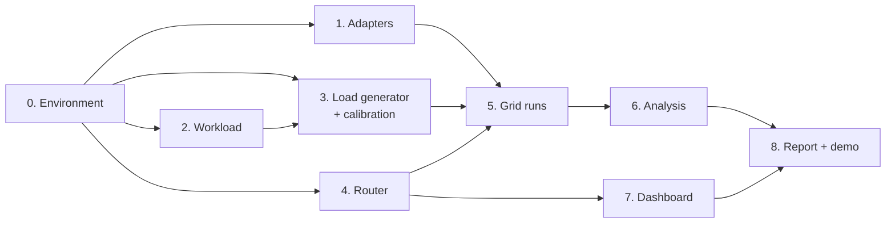

# Development Plan

The phases are listed in dependency order, and each has exit criteria that must be met before the results built on it can be trusted. Phases 1–4 can proceed in parallel once Phase 0 is done.

## Phase 0: Environment
- Build a Singularity + conda overlay with a pinned vLLM version, `peft`, `trl`, `bitsandbytes`, `datasets`, `httpx`/`aiohttp` and `pandas`.
- Download `meta-llama/Llama-3.1-8B-Instruct` once to HPC scratch, and point every tool at the local path.
- Smoke test: serve the base model with `--enable-lora` on one GPU, then send a chat request and a request naming a dummy LoRA adapter.
- Write a Slurm template that uses account `csci_ga_3033_085-2026fa`, includes the partition choice and starts two vLLM servers on one node.

**Exit:** both GPUs on a `c24m170-a100-2` node serve the base model plus a LoRA adapter, and we can reach both servers from a script on the same node.

## Phase 1: Adapters
- Prepare the finance data (Financial PhraseBank, FiQA-SA, ConvFinQA) and code-instruction data in one chat format.
- Train QLoRA (rank 8) on 1× A100 for each domain, with a fixed number of steps and no hyperparameter sweeps.
- Evaluate the base model and each adapter on its own task (finance accuracy and F1, HumanEval pass@1), with the adapter served by vLLM on the bf16 base. That's the same configuration the benchmark uses.

**Exit:** two adapter directories, plus a small score table showing each adapter beats the base model on its domain.

## Phase 2: Workload generator
- Build the session corpora: finance reports with question turns, and source files with question or edit turns.
- Write a trace generator with a fixed seed, configurable mix, number of turns and output-length cap.
- Validate offline by tokenizing traces and checking the prompt-length distributions and the shared-prefix length per turn.

**Exit:** traces for 50:50, 70:30 and 90:10 mixes, with documented length statistics.

## Phase 3: Load generator and calibration
- Write an async streaming client that replays a trace with Poisson session arrivals and records TTFT, TPOT and end-to-end latency per request.
- Write a `/metrics` scraper and GPU sampler.
- **Calibration** on one replica, hitting vLLM directly:
  - Unloaded TTFT and TPOT → set the SLO (for example, a fixed multiple of unloaded p50; decide once and record it).
  - Sweep the rate until the replica saturates → choose the ~5 rate levels for the grid, spanning both replicas' combined capacity.

**Exit:** the SLO values and rate levels are written to `configs/grid.yaml`.

## Phase 4: Router
- Build an OpenAI-compatible async proxy with streaming passthrough.
- Implement the three policies as pure functions, plus in-flight tracking and the session map.
- Write unit tests with fake backends covering each policy's choice, the hybrid's threshold behavior and session map updates.
- Measure the router's overhead: TTFT through the router vs. direct, at low load.
- Add a routing-event log and an endpoint to reset state between runs.

**Exit:** tests pass, and the router adds negligible latency compared to the SLO.

## Phase 5: Grid runs
- Write a driver that reads `configs/grid.yaml` and, for each (policy, mix, rate, repeat):
  1. resets the prefix caches and router state;
  2. warms up;
  3. runs for a fixed duration;
  4. drains;
  5. writes the run directory.
- Make it resumable: skip runs whose results already exist, because nodes can be preempted or shut down when idle.
- Do a pilot first: one repeat of the full grid at a short duration, to check the numbers look sane. Then do the full 3 repeats.

**Exit:** 45 configurations × 3 repeats, all with complete result files.

## Phase 6: Analysis
- Compute goodput over the steady-state window, prefix hit rate and p95/p99 TTFT.
- Plots: goodput vs. rate (one panel per mix), the crossover mix, hit rate per policy, and tail latency.
- Show variance across repeats with error bars.

**Exit:** the figures and tables for the report.

## Phase 7: Dashboard
- A live view of routing events by replica, colored by domain, alongside the running hit rate and rolling goodput.
- Demo mode: replay one trace while switching the policy or mix.

## Phase 8: Report and demo
- Report: question, setup, method, results, crossover, limitations.
- Recorded demo as a backup to the live demo.

## GPU budget (300 GPU-hour allocation)

| Item | Estimate |
|---|---|
| Environment and smoke tests (prefer L4 partitions) | ~5 GPU-h |
| Adapter training + eval (1× A100) | ~15–25 GPU-h |
| Calibration | ~5 GPU-h |
| Pilot grid | ~8 GPU-h |
| Full grid (45 × 3, ~5 min each, 2 GPUs) | ~25 GPU-h |
| Reruns and dashboard demo | ~20 GPU-h |
| **Total** | **~80–90 GPU-h** |

## Risks

| Risk | Mitigation |
|---|---|
| Idle-GPU auto-shutdown (20 min) kills interactive sessions | Run the grid as batch jobs; checkpoint each run |
| vLLM metric or API names differ by version | Pin the version; check metric names during the Phase 0 smoke test |
| Cache effects are too small to see | Make sure sessions have long shared prefixes and several turns; verify the hit rate in the pilot |
| No crossover appears in the tested range | Still a result. Report it, and check whether rates reach saturation |
| QLoRA adapter served on the bf16 base loses quality | Phase 1 evaluates on the exact served configuration |
